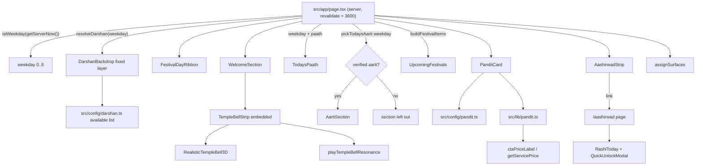

# Design Document: Digital Mandir Home

## Overview

The home page (`src/app/page.tsx`) becomes a calm "digital mandir". The visitor rings a bell, reads today's paath, does aarti, sees festivals, meets one honest Pandit Ji, and can take a small ₹11 step.

New page order:

1. Welcome and Temple Bell (replaces `Hero`; holds the only `h1`)
2. आज का पाठ (`TodaysPaath`, existing)
3. आरती (`AartiSection`, new, hidden until verified)
4. Festivals (`UpcomingFestivals`, existing, skipped when empty)
5. पंडित जी (`PanditCard`, new)
6. ₹11 Aashirwad (`AashirwadStrip`, existing, now links to `/aashirwad`)

`FestivalDayRibbon` stays above Welcome and shows only on festival days.

Design rules that drive every choice:

- **Nothing fake.** Every fact comes from a config file or a real data source. Unverified text never leaves the server.
- **Server decides, client renders.** The IST weekday is computed on the server and passed as a prop. No `Date` or `Math.random` in client first render, so there is no hydration mismatch.
- **Pure logic in `.ts` files.** Picking the aarti, hiding Pandit fields, building the buy ladder and assigning surfaces are small pure functions. They are the parts we test with property-based tests.
- **Bright temple look.** Ivory, saffron, gold, ink. Motion uses only `transform` and `opacity`. Reduced motion is respected.

### Research notes (what informed the design)

- `package.json` has `vitest 5.0.5`, no `fast-check`. `vitest.config.ts` runs `src/**/*.test.ts` in the `node` environment, so tests target pure `.ts` modules, not rendered components. I checked the registry: `fast-check` latest is `4.10.2`.
- `src/lib/ist-time.ts` already exports `istWeekday(ms)` (0 = Sunday) and `getServerNow()`. The current page hand-rolls the weekday with `toLocaleDateString`. The new page uses `istWeekday`.
- `src/lib/paath/registry.ts` already uses a `verified` flag and `getTodaysPaath(weekday)`. The aarti library copies this exact pattern.
- `src/lib/service-catalog.ts` exports `ctaPriceLabel(id)`, "the only way CTAs print a price". It calls `getServicePrice`. The buy ladder uses it. `src/__tests__/cta-scan.test.ts` scans `.tsx` files and fails on hard-coded `(₹N)` inside `request-guidance` links, so prices must never be typed in a component.
- `RealisticTempleBell3D` already has `role="button"`, `tabIndex`, Enter/Space handling. It has an English-only `aria-label` and an infinite idle sway that ignores reduced motion. Both need a small additive fix (see Components).
- `LanguageContext` always renders `en` first and switches after mount, so using `useT()` in new sections is hydration safe. `getTranslation` falls back to `en`, so new keys need only `en` and `hi`.
- AGENTS.md says this Next.js (16.3.0) has breaking changes. Before writing code, the implementer reads the relevant guide in `node_modules/next/dist/docs/` (route segment config `revalidate`, `metadata`, `next/link`, `next/image`).

### Decision made by the Owner: keep the ₹11 flow

`AashirwadStrip` scrolls to `#rashi-today`, which lives inside `RashiToday`. `RashiToday` + `QuickUnlockModal` is also the only ₹11 purchase path, and the header menu links to `/#rashi-today`. The Owner decided to KEEP the ₹11 flow. So `RashiToday`, `QuickUnlockModal` and their helpers stay, are hosted on a new small page `/aashirwad`, and the strip and the header link point there.

### New feature: Darshan backdrop

The Owner added a weekday deity image behind the page. It shows as the full-bleed "darshan" at the top (Welcome_Section) and stays as a fixed layer behind the other sections. See the "Darshan backdrop" component section below.

## Architecture



Data flow rules:

- `page.tsx` is a server component. It computes `weekday`, calls the pure picker, and passes only the chosen verified aarti to the client component. Lyrics of unverified aartis are never serialized into the page.
- Client components receive plain serializable props. No client component fetches data at first load (Requirement 12.4). The aarti `<audio>` uses `preload="none"`.
- Section surfaces are assigned by a pure helper so neighbours never match, even when optional sections are missing.

## Components and Interfaces

### Page composition (`src/app/page.tsx`)

```tsx
export const revalidate = 3600;

export default async function Home() {
  const [todayEvent, upcomingEvents] = await Promise.all([getTodayEvent(), getUpcomingEvents()]);
  const serverNow = getServerNow();
  const weekday = istWeekday(serverNow);
  const todayYmd = new Date(serverNow).toLocaleDateString("en-CA", { timeZone: "Asia/Kolkata" });
  const festivals = buildFestivalItems(upcomingEvents, todayYmd, 10);
  const todaysPaath = getTodaysPaath(weekday);
  const aarti = pickTodaysAarti(weekday);             // null when nothing is verified
  const surfaces = assignSurfaces([
    "welcome", "paath",
    ...(aarti ? ["aarti" as const] : []),
    ...(festivals.length ? ["festivals" as const] : []),
    "pandit", "aashirwad",
  ]);
  const darshan = resolveDarshan(weekday);            // { key, src } or null
  // render:
  // <div className="relative isolate">
  //   <DarshanBackdrop darshan={darshan} />           (fixed layer, z-0, renders nothing when null)
  //   <div className="relative z-10"> FestivalDayRibbon, Welcome, seam, Paath, seam,
  //     [Aarti, seam], [Festivals, seam], Pandit, seam, Aashirwad </div>
  // </div>
}
```

The wrapper must have no `transform`, `filter`, `perspective` or `overflow` clipping, because these make a `position: fixed` child behave like `absolute` and the backdrop would scroll away.

Notes:

- `getDailyPanchang()` is no longer called on the home page. Only `Hero` and `CelestialLiveTicker` used it, and both are removed. This removes one server fetch.
- The page keeps `revalidate = 3600`. The existing page exports no `metadata`; the site metadata lives in `src/app/layout.tsx` and stays untouched.
- Known limit: because of `revalidate = 3600`, the weekday can be up to one hour late after IST midnight. This is the same as today's paath behaviour and is accepted.

### `assignSurfaces` (`src/lib/home-surfaces.ts`, pure)

```ts
export type SectionKey = "welcome" | "paath" | "aarti" | "festivals" | "pandit" | "aashirwad";
export type Surface = "bronze" | "obsidian" | "saffron";
export function assignSurfaces(keys: SectionKey[]): Record<string, Surface>;
```

Rule: `festivals` always uses `saffron` (its current fixed class). Every other section alternates `bronze` / `obsidian` in order, continuing the toggle across the festival section. Result: no two neighbours share a surface for any subset of optional sections (Requirement 1.4).

Existing `TodaysPaath` gets an optional `surface` prop (default `obsidian`, so current behaviour is unchanged).

**Interaction with the Darshan backdrop (decision).** Surface alternation still applies and Requirement 1.4 stays as written. The three surface names now map to glass tints: `obsidian` = ivory glass `bg-[#FBF6EC]/85`, `bronze` = cream glass `bg-[#F5EAD6]/85`, `saffron` = a saffron wash with at least 85% opacity. Neighbours still differ in tint, so the rhythm is kept. A small helper `glassClass(surface)` in `home-surfaces.ts` returns the class string, so the opacity and blur live in one place. When no deity image is available the same classes sit on the plain ivory page, which looks like today's surfaces.

### Darshan backdrop (`src/lib/darshan.ts`, `src/config/darshan.ts`, `src/components/home/DarshanBackdrop.tsx`)

**Pure picker (`src/lib/darshan.ts`)**

```ts
export type DeityKey = "shiv" | "hanuman" | "durga" | "vishnu";
export const DARSHAN_BY_WEEKDAY: readonly DeityKey[] =
  ["vishnu", "shiv", "hanuman", "vishnu", "vishnu", "durga", "hanuman"]; // index 0 = Sunday

/** null when weekday is not an integer 0..6. */
export function pickDarshanImage(weekday: number): DeityKey | null;

export interface ResolvedDarshan { key: DeityKey; src: string }   // src = /images/darshan/<key>.jpg
/** Picks the deity, then returns it only if its file is in the available list. */
export function resolveDarshan(
  weekday: number,
  available: readonly DeityKey[] = AVAILABLE_DARSHAN,
): ResolvedDarshan | null;
```

Mapping: Sun vishnu, Mon shiv, Tue hanuman, Wed vishnu, Thu vishnu, Fri durga, Sat hanuman.

**Missing-file rule (decision).** `src/config/darshan.ts` exports `AVAILABLE_DARSHAN: DeityKey[]`, a short list the Owner edits when he adds a file. It starts empty, so the page works with no images. Why a config list and not `fs.existsSync`:

- The page is static with `revalidate = 3600`. On Vercel, the re-render after the first build may run where `public/` is not on the function's disk, so `existsSync` could wrongly say "missing" and hide a good image. A config list is the same in every environment.
- A config list is pure, so it can be tested with property tests. `fs` cannot.
- The list can drift from the real files. A small test in `darshan.test.ts` guards this: for each key in `AVAILABLE_DARSHAN`, the file `public/images/darshan/<key>.jpg` must exist. This test reads the disk in the Node test environment, which is safe.

Result: no broken image is ever sent. When the file is not listed, `resolveDarshan` returns `null` and the page shows the normal ivory surface.

**Component (`DarshanBackdrop`, server-safe, no client JS)**

- Props: `{ darshan: ResolvedDarshan | null }`. Returns `null` when `darshan` is `null`.
- Renders ONE `<div aria-hidden="true" className="fixed inset-0 z-0 pointer-events-none">` containing ONE `next/image` with `src={darshan.src}`, `alt=""`, `fill`, `priority`, `sizes="100vw"`, `className="object-cover"`. It never uses `background-attachment: fixed`, which is broken on iOS Safari, and never uses `will-change`.
- **One image, one request (decision).** The Owner asked for a hero image and a fixed layer. Both would show the same picture, so the design uses the single fixed image as both. The Welcome section is a transparent, near full-screen window (`min-h-[88svh]`) onto this layer, and later sections scroll over it as glass cards. This means one ``, one decode, one network request, and `priority` on the one LCP image. Two copies would cost an extra element and risk a second fetch.
- **Alt text (decision).** `alt=""` plus `aria-hidden`. The deity is decoration here; the meaning is carried by the h1 and the text. The backdrop is not content a screen reader user needs read out on every page load.
- Static position, no parallax, no scroll listener, no transform on the image. Reduced motion has nothing to turn off because the image never moves. The image may fade in once with `opacity` only, and only when Reduced_Motion is off (a CSS class guarded by the existing reduced-motion rule).

**Glass cards.** `glassClass(surface)` returns, for example, `bg-[#FBF6EC]/85 backdrop-blur-[6px] md:backdrop-blur-md`. Blur is 6px on mobile (cap is 8px), and `will-change: backdrop-filter` is never used. Text stays `#2A1810`. Worst case is the glass over a black photo pixel: ink on `85% ivory + 15% black` is about 11:1, so 4.5:1 is met on any image.

### `WelcomeSection` (`src/components/home/WelcomeSection.tsx`, client)

- Props: `{ surface: Surface; hasDarshan: boolean }`.
- Layout: a full-bleed section, `min-h-[88svh]` when `hasDarshan` (otherwise the normal padded ivory section). The text sits in an ivory glass panel (`bg-[#FBF6EC]/85`, light blur) pinned to the lower part of the section, so the deity shows above it. **Text-contrast choice:** an ivory glass panel with dark ink text, not light text on a dark scrim. This keeps the brand rule "dark text on light" and needs no gradient overlay.
- Renders `<section aria-labelledby="welcome-title">` with the only `<h1 id="welcome-title">` showing `मंदिर में आपका स्वागत है` (font Tiro Devanagari via `font-devanagari`, large, ink colour), a one-line sub text from `t("welcome.sub")`, then `<TempleBellStrip embedded />`. The bell sits inside the glass panel.
- No counts, no "live", no timers (Requirement 2.6).
- Entrance: one `motion` wrapper with `opacity` and `y`, `useReducedMotion()` turns it off.

### `TempleBellStrip` (existing, small change)

- Reuse as is, plus:
  - `embedded?: boolean` prop. When true it renders a `div` without its own `<section>` and surface class (so Welcome owns the surface).
  - Strings go through `useT()` (`bell.hint`, `bell.rung`, `bell.label`). The Hindi line "घंटी बजाएँ, मन शांत करें" stays as the `hi` value.
  - Passes `reduceMotion={useReducedMotion()}` and `ariaLabel={t("bell.label")}` to the bell.
  - Clears its `setTimeout` on unmount.
- Sound is unchanged: `playTempleBellResonance(432)`.

### `RealisticTempleBell3D` (existing, additive change only)

- Two new optional props: `reduceMotion?: boolean` and `ariaLabel?: string`. Defaults keep today's behaviour, so `GlassAstralPanchang` (the other user) is not affected.
- When `reduceMotion` is true: no idle sway (`repeat: Infinity`) and no swing keyframes; the sound still plays. Sound-wave rings are skipped.
- The component keeps `role="button"`, `tabIndex={0}`, Enter/Space handling. Sound and 3D look are not changed.

### Aarti library (`src/lib/aarti/`)

`types.ts`

```ts
export type AartiId = "hanuman" | "shiv" | "durga" | "om-jai-jagdish";

export interface AartiConfig {
  id: AartiId;
  deity: string;           // "Lord Hanuman"
  titleHi: string;         // "श्री हनुमान जी की आरती"
  titleEn: string;
  lyrics: string[];        // lines, supplied by the Owner / Pandit Ji
  weekdays: number[];      // 0 = Sunday ... 6 = Saturday
  verified: boolean;       // true only after Pandit Ji has checked the text
  audioSrc?: string;       // file under /public, supplied by the Owner
}

/** What the client gets: only a verified aarti with lyrics. */
export type VerifiedAarti = AartiConfig & { verified: true; lyrics: [string, ...string[]] };
```

`config.ts` holds `AARTIS: AartiConfig[]` with the four entries. All start with `verified: false` and `lyrics: []`. The lyrics are filled by the Owner or Pandit Ji; the design does not invent or copy text from memory.

Weekday plan (every day has exactly one aarti):

| Day | Aarti |
|-----|-------|
| Sun (0) | Om Jai Jagdish |
| Mon (1) | Shiv |
| Tue (2) | Hanuman |
| Wed (3) | Om Jai Jagdish |
| Thu (4) | Om Jai Jagdish |
| Fri (5) | Durga |
| Sat (6) | Hanuman |

`pick.ts`

```ts
export function pickTodaysAarti(
  weekday: number,
  aartis: readonly AartiConfig[] = AARTIS,
): VerifiedAarti | null;
```

Rules:

1. If `weekday` is not an integer in 0..6, return `null`.
2. Keep only entries with `verified === true` and at least one non-blank lyric line.
3. Return the first kept entry (config order) whose `weekdays` includes `weekday`, otherwise `null`.

Because the page only renders `AartiSection` when the result is not `null`, an unverified aarti never shows text (Requirements 4.4, 4.5, 10.3) and the whole section is left out while nothing is verified (Requirement 13.3).

### `AartiSection` (`src/components/home/AartiSection.tsx`, client)

- Props: `{ aarti: VerifiedAarti; weekday: number; surface: Surface }`.
- Content: eyebrow `t("aarti.eyebrow")` + `t(`day.${weekday}`)`, `<h2>` with `titleHi`, lyrics as a list of lines, the Diya_Button, and the optional audio control.
- **Diya_Button**: a real `<button type="button">` with `aria-label={t("aarti.diya_label")}`. Enter and Space work natively. On press it increments a `wave` counter. The diya is an inline SVG. The wave is a `motion.div` keyed by `wave` that animates only `rotate`, `y`, `scale` and `opacity`.
- **Reduced motion**: the wave is skipped. A glow `<span>` changes `opacity` for 600 ms instead.
- **Audio**: rendered only when `aarti.audioSrc` is set. A play/pause `<button>` controls a hidden `<audio preload="none">`. `onError` sets `audioFailed`, which removes the control and keeps the lyrics (Requirement 4.13). Audio files come from the Owner only.
- No count claims such as "N people did aarti".

### Pandit library (`src/config/pandit.ts`, `src/lib/pandit.ts`)

`src/config/pandit.ts` is the only place with Pandit Ji's real details:

```ts
export interface PanditProfile {
  name?: string;
  photoSrc?: string;        // path under /public
  city?: string;
  yearsOfPractice?: number;
  languages?: string[];
}
export const PANDIT: PanditProfile = {};   // empty until the Owner answers
```

`src/lib/pandit.ts` (pure):

```ts
export interface VisiblePanditFields {
  name?: string; photoSrc?: string; city?: string; yearsOfPractice?: number; languages?: string[];
}
export function getVisiblePanditFields(p: PanditProfile): VisiblePanditFields;

export interface BuyOffer { id: "quick-answer" | "vedic-guidance" | "temple-puja"; href: string; priceLabel: string; }
export function buildBuyLadder(priceLabel?: (serviceId: string) => string): BuyOffer[];
```

`getVisiblePanditFields` rules:

- A string field is visible only if it has a non-blank value after `trim()`; the trimmed value is returned.
- `yearsOfPractice` is visible only if it is a finite integer from 1 to 80.
- `languages` keeps only non-blank trimmed entries and is visible only if at least one remains.
- **Name gate:** if there is no visible `name`, the result is `{}`. A city, years or photo without a name would be an anonymous claim, so the card then shows only the heading and promises (Requirement 6.5). This resolves the small overlap between Requirements 6.2 and 6.5 in favour of 6.5.

`buildBuyLadder` always returns exactly three offers in this order, with the default `priceLabel = ctaPriceLabel` (which uses `getServicePrice`):

| Order | id | href |
|-------|----|------|
| 1 | `quick-answer` | `/quick-answer` |
| 2 | `vedic-guidance` | `/request-guidance?service=vedic-guidance` |
| 3 | `temple-puja` | `/request-guidance?service=temple-puja` |

Prices are never typed in the component, so a price change in `src/lib/pricing.ts` shows up without any other edit (Requirement 6.13).

### `PanditCard` (`src/components/home/PanditCard.tsx`, client)

- Props: `{ profile: VisiblePanditFields; offers: BuyOffer[]; surface: Surface }`. The server page calls `getVisiblePanditFields(PANDIT)` and `buildBuyLadder()` and passes the results.
- Renders `<h2>पंडित जी</h2>`. Each visible field renders with its label; hidden fields render nothing (no empty label).
- Photo: shown only if `photoSrc` is visible. Uses `next/image`; an `onError` handler removes it so no broken image or placeholder face ever shows.
- Three honesty promises through `useT()`: no fear-selling, no guaranteed results, an honest answer.
- Buy ladder: three `next/link` anchors with `min-h-[44px]` touch targets, visible `focus-visible:ring-2` focus, and the `₹` price label from `offers`.
- Contains no rating, review, customer count, "live"/"online now", countdown, or limited-seats text.

### `AashirwadStrip` (existing, small change)

- The `<button>` that scrolls to `#rashi-today` becomes a `next/link` to `/aashirwad` with the same classes, text, `₹11` and `pixelContact("aashirwad_strip_11")` in `onClick`.
- The wrapper receives a surface class from the page so it does not match the Pandit card above it.

### `/aashirwad` page (`src/app/aashirwad/page.tsx`, new, server)

- Renders a short `<h1>` ("आज का आशीर्वाद") and the existing `<RashiToday serverNow={getServerNow()} />`, which already contains the ₹11 flow and `id="rashi-today"`.
- Exports `metadata` (title and description). Header link `/#rashi-today` in `src/components/layout/Header.tsx` changes to `/aashirwad`.

### Translations (`src/lib/translations.ts`)

New keys use the existing `{ en, hi, ... }` shape with `en` and `hi` filled (other languages fall back to `en`): `welcome.sub`, `bell.hint`, `bell.rung`, `bell.label`, `aarti.eyebrow`, `aarti.diya_label`, `aarti.audio_play`, `aarti.audio_pause`, `pandit.title`, `pandit.promise.1..3`, `pandit.offer.quick.title`, `pandit.offer.guidance.title`, `pandit.offer.sankalp.title`, `pandit.field.city|years|languages`.

## Data Models

```ts
// IST weekday: integer 0..6, 0 = Sunday. Computed on the server only.
type Weekday = 0 | 1 | 2 | 3 | 4 | 5 | 6;

// Aarti config entry -> see AartiConfig above (verified flag + lyrics + weekdays + optional audioSrc)
// Pandit config -> see PanditProfile above (all fields optional)

// Buy ladder offer -> BuyOffer above; price text comes from ctaPriceLabel(id)

// Surface assignment: Record<SectionKey, Surface>
```

No database tables, no new API routes, no new client network calls.

## Verified Delete List

The Owner approved deleting components that have zero importers after this change.

**Method.** A script scanned every `.ts`/`.tsx` file under `src` (including `src/__tests__`). A file counts as "imported" if any other live file has an import, `import(`/`next/dynamic` call or string path ending in `/<FileName>`. The new `page.tsx` was simulated: it imports only `TempleBellStrip` (via `WelcomeSection`), `TodaysPaath`, `UpcomingFestivals`, `AashirwadStrip`, `FestivalDayRibbon`, `WelcomeSection`, `AartiSection`, `PanditCard`, `Reveal`. The scan repeated until nothing new became unused (fixed point). Then each result was re-checked with a plain-text search for the component name across `src`, `scripts`, `docs` and `public`. Case-insensitive name matches (for example the route string `/services`) were treated as false positives and re-checked by hand.

### A. Home components removed from the page (importer today: only `src/app/page.tsx`)

| File | Evidence after change |
|------|-----------------------|
| `home/Hero.tsx` | Only importer `app/page.tsx`. Replaced by Welcome_Section. |
| `home/AstrologerRoster.tsx` | Only importer `app/page.tsx`. |
| `home/TestimonialCarousel.tsx` | Only importer `app/page.tsx`. |
| `home/PractitionerBio.tsx` | Only importer `app/page.tsx`. |
| `home/CelestialLiveTicker.tsx` | Only importer `app/page.tsx`. |
| `home/ChooseByConcern.tsx` | Only importer `app/page.tsx`. |
| `home/VerifiedDelivery.tsx` | Only importer `app/page.tsx`. A mention in `VedicToolsAndReportLookup.tsx` is a comment. |
| `home/FreeToolsRow.tsx` | Only importer `app/page.tsx`. |
| `home/PricingGrid.tsx` | Only importer `app/page.tsx`. |
| `home/3d/HeroCanvas.tsx` | Only importer `home/Hero.tsx` (dynamic import). |
| `home/3d/CosmicGalaxy.tsx` | Only importer `home/3d/HeroCanvas.tsx`. |
| `home/3d/GlassMandala.tsx` | Only importer `home/3d/HeroCanvas.tsx`. |
| `ui/Reveal3D.tsx` | Only importer `app/page.tsx`. |

### B. Home components that already have no importer (orphans)

Each name appears only in its own file (and, for some, in comments or in `translations.ts` section comments). No static import, no `import(`, no test, no string reference.

`AppShowcase`, `DigitalChadhava`, `FinalCta`, `GuidanceCategories`, `HowItWorks`, `InlineAskField`, `InteractiveTopics`, `LiveActivityFeed`, `PanchangHeader`, `RashiCalculator`, `ReferralBanner`, `SampleGuidance`, `SanctuaryTransitionBridge`, `SocialProof`, `Testimonials`, `TodayAuspicious`, `TraditionalServices`, `TrustPersonas`, `TrustPillarsStrip`, `VedicIntro`, `VedicToolsAndReportLookup`, `WhyChoose` (all `src/components/home/*.tsx`).

Heads-up for the Owner: `DigitalChadhava` (wallet offerings) and `VedicToolsAndReportLookup` are large, working components that nothing imports today. They are in git history if they are ever wanted back.

### C. Helpers that become unused only because of A and B

| File | Evidence (importers today, all inside the delete set) |
|------|----------------------------------------------------|
| `ui/TiltCard.tsx` | `home/ChooseByConcern.tsx` only. |
| `ui/VedicArtifactIcon.tsx` | `home/ChooseByConcern.tsx`, `home/PricingGrid.tsx`. (Its own import `ui/PremiumVedicIcon` is KEPT: also used by `guidance/GuidanceRequestForm.tsx`, `services/ServicesContent.tsx`.) |
| `ui/SectionHeading.tsx` | `home/AppShowcase.tsx` only. |
| `icons/CommunicationIcon.tsx` | `home/WhyChoose.tsx` only. |
| `icons/ConfidentialityIcon.tsx` | `home/WhyChoose.tsx` only. |
| `icons/HonestIcon.tsx` | `home/WhyChoose.tsx` only. |
| `icons/FestivalIcon.tsx` | `home/TraditionalServices.tsx` only. |
| `icons/LunarMonthIcon.tsx` | `home/TraditionalServices.tsx` only. |
| `icons/NakshatraIcon.tsx` | `home/TraditionalServices.tsx` only. |
| `icons/LotusIcon.tsx` | `home/VedicIntro.tsx` only. |

(All paths are under `src/components/`.)

### D. Public images used only by deleted files

`public/images/guidance/` : `property.jpg`, `business.jpg`, `career.jpg`, `education.jpg`, `family.jpg`, `guidance.jpg`, `marriage.jpg`, `wealth.jpg` (only `GuidanceCategories`), `cta-incense.jpg`, `cta-lotus.jpg` (only `FinalCta`), `ornamental-lotus.jpg` (only `HowItWorks`).

`AppShowcase` points at `/images/android_mockup.jpg`, `desktop_mockup.jpg`, `iphone_mockup.jpg`, which do not exist in `public/images`. Nothing to delete there.

Before deleting any image the implementer re-runs a repo-wide text search for its path (src, scripts, docs, `public`, `*.json`, `*.css`, `*.md`). A file with any hit stays.

### E. KEPT (with the importer named)

| Kept file | Why |
|-----------|-----|
| `calendar/GlassAstralPanchang.tsx`, `TodayEventCard.tsx`, `MoonPhaseGlyph.tsx`, `SankalpMandala.tsx` | `/shubh-calendar` uses them; `GlassAstralPanchang` imported by `TodayEventCard`. Required by Owner. |
| `ui/RealisticTempleBell3D.tsx`, `lib/celestialAudio.ts` | Temple_Bell and `GlassAstralPanchang`. Required by Owner. |
| `home/TempleBellStrip.tsx`, `TodaysPaath.tsx`, `UpcomingFestivals.tsx`, `AashirwadStrip.tsx`, `FestivalDayRibbon.tsx` | Used by the new `page.tsx`. |
| `home/Faq.tsx` | `app/faq/page.tsx`. |
| `home/Services.tsx` | Footer, Header, MobileMenu, FloatingNav, wallet page (checked by name; the earlier `sitemap.ts` hit is only a `/services` route string). |
| `home/3d/PlanetaryTransitWheel.tsx` | `app/transit-wheel/page.tsx`. |
| `ui/Reveal.tsx`, `ui/motion-presets.ts` | `Reveal` is used by the new sections; `motion-presets` is imported by `Reveal`. |
| `ui/PremiumVedicIcon.tsx` | `GuidanceRequestForm`, `ServicesContent`. |
| `ui/Button.tsx`, `ui/Card.tsx`, `ui/IconContainer.tsx`, `icons/PersonalizedIcon`, `SunriseIcon`, `TraditionalIcon`, `BusinessIcon`, `MarriageIcon`, `TrishulIcon` | `home/Services.tsx` and `layout/Header.tsx`. |
| `lib/guides.ts` | `layout/Chatbot.tsx`, `app/api/chat/route.ts`. |
| `lib/vedic-clock.ts` | `calendar/GlassAstralPanchang.tsx`, `app/decision-clock/page.tsx`. |
| `components/audio/PanditJiVoiceBlessing.tsx` | `reports/RoyalVedicReport.tsx`. |
| `shared/PayNowButton.tsx`, `lib/upi-config.ts`, `config/paytm-links.ts` | `wallet/TopupDrawer.tsx`, `shared/DonateModal.tsx`, `app/payment/[reference_id]/page.tsx`, API routes. |
| `ui/service-icons/*` | `ServiceIcon` used by other pages. |
| `ui/icons/LotusIcon.tsx`, `ui/icons/NakshatraIcon.tsx` | Different files from `icons/LotusIcon` and `icons/NakshatraIcon`. They have no importer today, but that is not caused by this change, so they are out of scope here. |

Pre-existing orphans unrelated to this change (for example `calendar/3d/*`, `forms/Step*.tsx`, `layout/Chatbot.backup.tsx`) are out of scope and untouched.

### F. The ₹11 flow (KEPT, Owner decision)

Because `/aashirwad` imports `RashiToday`, these stay: `home/RashiToday.tsx`, `home/QuickUnlockModal.tsx`, `home/3d/Rashi3DCanvas.tsx`, `home/3d/RashiMedallionCard.tsx`, `lib/zodiac-data.ts`, `lib/shubhmarg-assets.ts`, and `public/shubhmarg/rashi/*-3d.jpg` (referenced by `zodiac-data`).

These files are not on any delete list.

### G. Translation keys

Key families that probably become unused: `hero.*`, `stats.*`, `concern.*`, `roster.*`, `pricing.*`, `bio.*`, `testimonials.*`, `tools.*`. The implementer removes a key only after a script proves all of these for that exact key: no `t("key")` or `t('key')` literal anywhere in `src`; no template/prefix use such as ``t(`concern.${id}.title`)`` (a prefix hit keeps the whole family member set that the template can build); no use in tests. Keys `day.*` and `paath.*` are used with templates and stay. When unsure, the key stays.

Total files to delete: 13 (A) + 22 (B) + 10 (C) = 45 source files, plus the 11 images in D after their own check.

## Correctness Properties

*A property is a characteristic or behavior that should hold true across all valid executions of a system-essentially, a formal statement about what the system should do. Properties serve as the bridge between human-readable specifications and machine-verifiable correctness guarantees.*

This feature uses property-based testing for the pure logic in this feature: the aarti picker, the Pandit field filter, the buy ladder and the surface assignment. It does not fit the React components (rendering, motion, audio) or the delete list; those use example tests, file-read tests and the build.

Darshan properties (7 to 9) cover the weekday picker and the missing-file rule. The contrast, fixed-layer and motion rules are CSS and layout, so they use file-read example tests and manual checks.

Reflection result: the "unverified text never shows" rules (4.4, 4.5, 4.6, 10.3, 13.3) are all one statement about the picker, so they are folded into Properties 1 and 2. The Pandit rules (6.2 to 6.5, 13.1) fold into Properties 3 and 4. The `₹` rule (11.6) folds into Property 5.

### Property 1: Aarti picker only returns safe, matching aartis

*For any* list of aarti entries (random `verified` flags, random lyrics including empty and blank lines, random weekday lists) and *for any* integer weekday, `pickTodaysAarti` returns either `null` or an entry that is verified, has at least one non-blank lyric line, and whose `weekdays` includes the given weekday. *For any* non-integer or out-of-range weekday it returns `null`.

**Validates: Requirements 4.2, 4.4, 4.5, 10.3**

### Property 2: Aarti picker finds the first match, and nothing verified means nothing shown

*For any* list of aarti entries and *for any* weekday in 0..6, if at least one entry is verified, has non-blank lyrics and includes the weekday, the picker returns the first such entry in list order; otherwise it returns `null`. In particular, *for any* list where every entry has `verified: false`, the result is `null` for all seven weekdays, and the shipped `AARTIS` config (all unverified) yields `null` on every weekday.

**Validates: Requirements 4.2, 4.5, 4.6, 13.3**

### Property 3: Pandit fields show only real values and hide everything else

*For any* `PanditProfile` (each field randomly missing, empty, whitespace-only, or real; years random including zero, negative, fractional and huge; languages with blank entries), `getVisiblePanditFields` returns: `{}` when the name is missing or blank; otherwise exactly the fields with real values, with strings trimmed, languages reduced to non-blank entries, years only when a finite integer from 1 to 80, and no key for any missing or empty field.

**Validates: Requirements 6.2, 6.3, 6.4, 6.5, 13.1**

### Property 4: Pandit field filtering is idempotent

*For any* `PanditProfile` `p`, `getVisiblePanditFields(getVisiblePanditFields(p))` equals `getVisiblePanditFields(p)`.

**Validates: Requirements 6.2, 6.3**

### Property 5: Buy ladder keeps its order and takes prices only from the price source

*For any* price-label function `f`, `buildBuyLadder(f)` returns exactly three offers with ids `quick-answer`, `vedic-guidance`, `temple-puja` in that order, with the fixed hrefs `/quick-answer`, `/request-guidance?service=vedic-guidance` and `/request-guidance?service=temple-puja`, and each `priceLabel` equals `f(id)`. With the default label function, each label contains `₹`, never contains `Rs.`, and contains the digits of `getServicePrice(id)`.

**Validates: Requirements 6.8, 6.9, 6.10, 6.11, 6.12, 6.13, 11.6**

### Property 6: Neighbouring sections never share a surface

*For any* ordered subset of the optional sections (`aarti`, `festivals`) placed between the fixed sections `welcome`, `paath`, `pandit`, `aashirwad`, `assignSurfaces` gives every section a surface, gives `festivals` the `saffron` surface, and gives no two neighbouring sections the same surface.

**Validates: Requirements 1.2, 1.4**

### Property 7: Darshan picker is total and follows the weekday table

*For any* integer weekday from 0 to 6, `pickDarshanImage` returns one of `shiv`, `hanuman`, `durga`, `vishnu`, and the result equals `shiv` for 1, `hanuman` for 2 and 6, `durga` for 5, and `vishnu` for 0, 3 and 4.

**Validates: Requirements 14.1**

### Property 8: Darshan picker rejects invalid weekdays

*For any* value that is not an integer from 0 to 6 (negative, above 6, fractional, `NaN`, `Infinity`), `pickDarshanImage` returns `null` and `resolveDarshan` returns `null`.

**Validates: Requirements 14.2**

### Property 9: Darshan image is returned only when its file is listed

*For any* weekday from 0 to 6 and *for any* subset of deity keys used as the available list, `resolveDarshan` returns `null` when the picked key is not in the subset, and otherwise returns `{ key, src }` with `src` equal to `/images/darshan/<key>.jpg`.

**Validates: Requirements 14.3, 14.4**

## Error Handling

| Situation | Behaviour |
|-----------|-----------|
| IST weekday is not 0..6 | `pickTodaysAarti` returns `null`; the Aarti section is left out. `getTodaysPaath` already falls back to Hanuman Chalisa. |
| No aarti is verified (all of them at launch) | Aarti section is not rendered; the page order for the other sections is unchanged. |
| Aarti is marked `verified: true` but has no lyrics | Treated as unverified; section left out (no empty card). |
| Aarti `audioSrc` missing | No audio control; lyrics only. |
| Aarti audio file fails to load (`onError`) | Audio control is removed; lyrics stay visible. |
| `PANDIT` config empty or has no name | Card shows only "पंडित जी", the honesty promises and the buy ladder. |
| `PANDIT.photoSrc` set but the file is missing | `onError` removes the image; no broken image and no placeholder face. |
| A service id is missing from the pricing table | `getServicePrice` already falls back to its default price; the label still shows `₹`. The existing `cta-scan` test catches unknown ids in links. |
| Deity file for today is not in `AVAILABLE_DARSHAN` | `resolveDarshan` returns `null`; no image element, plain ivory surface, glass cards sit on ivory. No broken image. |
| Listed image fails to load in the browser | The fixed layer shows nothing there; the ivory page base shows through. Text contrast is unchanged because it never depends on the image. |
| Weekday is invalid | `pickDarshanImage` returns `null`; same as a missing file. |
| No upcoming festivals | `UpcomingFestivals` is not rendered; surfaces are re-assigned so neighbours still differ. |
| `getTodayEvent` / `getUpcomingEvents` fail | Unchanged from today (they already return safe values from `src/lib/calendar.ts`); the page does not add new failure paths. |
| `prefers-reduced-motion` is on | Bell: sound plays, no sway or swing. Diya: short glow change instead of the wave. Reveal animations are off. |
| Visitor with JavaScript slow or off | Server-rendered text, links and the buy ladder are visible; only the bell, diya and audio need JavaScript. |

## Testing Strategy

**Dual approach.** Property tests cover the pure logic across many inputs. Example and file-read tests cover single facts about the page. The build covers wiring and dangling imports.

### Library choice

- Use `fast-check`. It is not installed today. Add it as an exact, pinned dev dependency: `npm install --save-dev --save-exact fast-check@4.10.2`. It works directly inside Vitest tests; no extra Vitest adapter is needed.
- Do not write a custom random generator or shrinker.
- Each correctness property is ONE `fc.assert(fc.property(...), { numRuns: 100 })` test (100 runs minimum).
- Each test carries a comment tag in this format: `Feature: digital-mandir-home, Property N: <property text>`.
- `vitest.config.ts` only runs `src/**/*.test.ts` in the `node` environment, so all new tests are `.ts` files against pure modules. No jsdom is added.

### New test files (`src/__tests__/`)

| File | Content |
|------|---------|
| `aarti-pick.test.ts` | Property 1 and Property 2. Example: `AARTIS` has the four ids and every entry is `verified: false`; every weekday 0..6 maps to exactly one entry in the weekday plan. |
| `pandit.test.ts` | Properties 3, 4 and 5. Examples: empty `PANDIT` gives `{}`; the three hrefs; default labels match `getServicePrice` for the real pricing table. |
| `home-surfaces.test.ts` | Property 6. |
| `darshan.test.ts` | Properties 7, 8 and 9. Examples: the Mon/Tue/Fri/Sat/other mapping; every key in `AVAILABLE_DARSHAN` has a file at `public/images/darshan/<key>.jpg`; contrast of ink `#2A1810` over `#FBF6EC` at 85% on black is at least 4.5. |
| `home-page-contract.test.ts` | File-read examples (style of `preservation.test.ts`): `page.tsx` has no import of any deleted component, exports `revalidate = 3600`, imports `istWeekday`; the only `<h1` in the Welcome section file and none in the other home section files; `PanditCard.tsx` and `AartiSection.tsx` contain no banned words (`rating`, `reviews`, `Rs.`, `online now`, `limited`, `countdown`) and no `₹` followed by digits; `DarshanBackdrop.tsx` has `fixed`, `priority`, `sizes="100vw"`, `alt=""` and none of `background-attachment`, `will-change`, `useScroll`, `scroll` listeners; the home sources use no `backdrop-blur` above 8px below the `md` breakpoint; every relative or `@/` import under `src` resolves to an existing file (guards the delete list). |

### Existing safety net

- The existing 43 Vitest tests must keep passing. `cta-scan.test.ts` walks every `.tsx` file in `src` and checks that it finds more than 10 `request-guidance?service=` or `serviceId=` matches. After the 45 deletions the implementer re-checks this count still passes. The new `PanditCard` must not hard-code a price, which the scan would flag.
- `ist-time.test.ts` already covers `istWeekday`.

### Verification steps for implementation

1. Run the delete-list scan again just before deleting, and delete only files with zero importers. Keep a git commit boundary so the deletion can be reverted as one unit.
2. Run `npm run build` and confirm zero errors (this also type-checks the deleted-import fallout).
3. Run `npm test` (`vitest run`) and confirm all 43 old tests plus the new ones pass.
4. Terminal output on this machine can lag, so build and test commands write to log files (for example `build-home.log`, `test-home.log`) and the logs are read back to confirm results.
5. Manual checks (cannot be automated here): one `h1` on `/`, no horizontal scroll at 360 px, keyboard use of bell and diya, reduced-motion behaviour, contrast of text on `bronze`, `obsidian` and `saffron` surfaces, `/aashirwad` opens the ₹11 flow, header link works.

### Why other parts are not property-tested

React rendering, motion, audio and layout are UI. They get example checks and manual review, not property tests. The delete list is a one-time repo scan, so it uses a scan test and the build instead of random generation.
